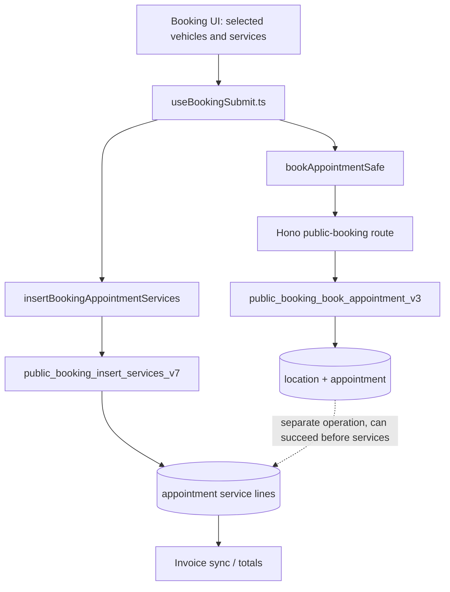

# Booking architecture reference audit

Status: design and source audit only; not implemented, tested, or deployed.
Scope: public booking, service lines, appointment location, invoices.

## External patterns inspected

- WooCommerce checkout: https://github.com/woocommerce/woocommerce/blob/trunk/plugins/woocommerce/includes/class-wc-checkout.php
  - Maps cart line items, fees, taxes and totals to a persisted order.
  - Re-reads the saved order and rejects an order if all persisted items are missing.
  - Its own code notes that this does NOT catch partial item loss. Our parity gate must compare every line, not merely nonzero count.
- pretix custom checkout: https://github.com/pretix/pretix/blob/master/doc/api/guides/custom_checkout.rst
  - Describes order creation as atomic: complete success or no order.
  - Cart reservations can be consumed only when order creation succeeds.
- Cal.com: https://github.com/calcom/cal.com
  - Scheduling reference candidate; no source-level scheduling behavior asserted until separately audited.

## Current Service Writer source trace (main branch)

Evidence:
- `src/hooks/useBookingSubmit.ts` calls `bookAppointmentSafe` near line 573 and `insertBookingAppointmentServices` near line 800. On main, insertion errors are caught and logged instead of aborting the confirmed booking. Line numbers are observational, not stable contracts.
- `src/application/commands/booking-submit.command.ts` calls `public_booking_insert_services_v7`.
- `src/server/hono/routes/public-booking.ts` calls `public_booking_book_appointment_v3`.
- `supabase/migrations/20261009173500_atomic_start_and_public_booking_location.sql` defines v3 to create the appointment and location; service line creation is outside that transaction.
- Existing repair PR #131 changes error handling but does not make the two RPC calls atomic. Do not merge it solely based on this audit.

## Target invariant and transaction

One server-authoritative checkout command must validate booking-enabled workspace, public catalog, date/time, location, vehicle ownership, selected services, quantities and price snapshots, then in **one database transaction**:
1. Enforce a unique idempotency key scoped to the workspace/customer request.
2. Resolve canonical services and prices server-side; reject inactive or cross-tenant catalog IDs.
3. Reserve/validate appointment capacity and create appointment-owned location.
4. Create appointment, vehicle/service lines and fees with immutable pricing snapshots.
5. Re-read persisted lines and compare exact multiset of (vehicle, catalog service, quantity, amount) to validated request; reject any missing, extra, or altered lines.
6. Derive totals and invoice draft from persisted lines; only then mark appointment confirmed.
7. Commit; dispatch email/payment side effects via an idempotent outbox after commit.

Any validation, persistence, or parity failure must roll back all new records and return a structured error. Never issue a zero-service confirmation. A fee or extra quart is not a substitute for a booked oil-change service.

## Release gates

- Zero services; invalid catalog; disabled workspace; cross-tenant ID: rejected, no appointment.
- Four vehicles/four oil changes plus one extra quart: five exact line items, correct vehicle mapping and total.
- Inject failure at service line 2 of 4: transaction rolls back appointment, location and all lines.
- Retry identical idempotency key: exactly one appointment/invoice; conflicting payload: 409.
- Concurrent booking for same capacity: only permitted reservations succeed.
- Verify tax, discounts, fee, card surcharge and pay-later states without double billing.
- Public anon route cannot directly execute privileged SECURITY DEFINER functions not intended for anonymous access.
- Existing issued invoices/payments are never silently rewritten during backfill; produce discrepancy reports and explicit repair approvals.
- Migration up/down or forward-only safety; schema-contract tests; Hono integration tests; browser smoke; tenant-isolation checks; production monitoring.

## Execution sequence

1. Inventory exact RPC signatures, table constraints, current booking contracts and existing migrations in a read-only database audit.
2. Implement new versioned atomic RPC and a single Hono endpoint behind a disabled feature flag; do not mutate legacy booking behavior.
3. Add DB integration tests with fault injection and complete item parity, then wire frontend to new endpoint.
4. Validate staging with realistic multi-vehicle bookings and invoices.
5. Review, pass CI, merge PR and roll out gradually; verify production read-only and monitor.
